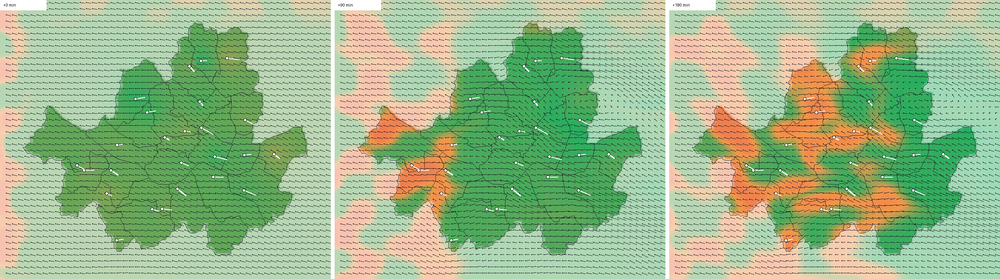

# Stable Fluid 프로토타입 (서울 바람·미세먼지)

담당: 김재겸 · 최종 발표용 서브기능 2(바람 기반 미세먼지 예측)의 사전 실험입니다.
`src/`에 들어가기 전 단계라 `make`로 빌드되지 않습니다.



## 보는 방법

**`view.html`을 더블클릭**하면 됩니다. (같은 폴더의 `meta.js`, `sim.js`를 읽음, 서버 불필요)
재생 버튼을 누르면 3시간 동안 바람 입자와 미세먼지가 움직이고, 오른쪽에 서울 평균 PM2.5 변화가 나옵니다.

## 무엇을 했나

- 서울 구 경계로 만든 **100m 격자 430 × 363 = 15.6만 칸** (서울 바깥 3km 여유 포함, 서울 안 606 km²)
- 측정소 25곳(`data/processed/stations.csv`) 위치에 **임의 바람** (서북서풍 기준 풍향 ±35°, 풍속 1.5 ~ 4.5 m/s)
- 초기 PM2.5: 2025년 2월 실제 평균을 역거리 가중 보간
- 시나리오: 바람이 불어오는 쪽에서 구름 모양 고농도 공기 덩어리(최대 +35)가 바람을 타고 들어옴
- C++, CPU 단일 스레드, STL 컨테이너 없이 `src/graph/DynamicArray.h` 사용

한 스텝(30초) 계산 순서

1. 외력: 측정소 주변(σ 1km) 바람을 관측값 쪽으로 당김 (τ 60초)
2. 이류: semi-Lagrangian, 최신 속도로 역추적
3. 투영: 압력 Jacobi 60회(이전 스텝 압력에서 시작)로 발산 제거
4. 미세먼지: 새 바람장으로 이류 + 감쇠, 유입 경계로 바깥 공기 유입

## 결과

| 항목 | 값 |
|---|---|
| 3시간 예측 (360스텝) | 11 ~ 18초, 스텝당 30 ~ 50ms |
| `DynamicArray` 범위 검사를 뺐을 때 | 약 2배 빠름 (스텝당 약 22ms) |
| 측정소 위치에서 관측 바람과의 차이 | 풍향 평균 5.6°, 풍속 평균 0.23 m/s |
| 최대 발산 (칸당 m/s) | 초기 보간 0.134 → 투영 후 0.031, 시뮬레이션 중 0.021 이하 |
| 서울 평균 PM2.5 | 20.9 → 26.2 |

## 다시 계산하기

```bash
cd prototype/stable_fluid
python prep.py                                              # 서울 마스크, input.txt, meta.js 생성
g++ -std=c++17 -O2 -I../../src wind_proto.cpp -o wind_proto
./wind_proto                                                # sim.js 생성
python snap.py                                              # (선택) snapshots.png, Pillow 필요
python fit.py                                               # (선택) 측정소 위치 바람 오차
```

설정값(격자 간격, 외력 세기, 시간 간격 등)은 `wind_proto.cpp` 맨 위에 있습니다.

## 파일

| 파일 | 내용 |
|---|---|
| `prep.py` | 서울 구 경계 → 격자 마스크, 측정소 입력(임의 바람 + 2월 평균 PM2.5) |
| `wind_proto.cpp` | 시뮬레이션 본체 |
| `view.html` | 결과 재생 화면 |
| `meta.js`, `sim.js`, `input.txt` | 생성된 데이터 (바로 볼 수 있게 함께 올림) |
| `seoul_gu.json` | 서울 구 경계 (출처: [southkorea/seoul-maps](https://github.com/southkorea/seoul-maps), 2013 통계청 경계 간소화본) |
| `snap.py`, `fit.py` | 장면 이미지 저장, 측정소 위치 오차 확인 |

## 한계와 다음 단계

- 바람은 임의 값입니다. S-DoT 실제 풍향·풍속으로 바꿔야 합니다. (`loadSdot`, 장데니스 바람 보정과 연결)
- 지형을 반영하지 않습니다. 북한산·관악산 등에서 바람이 갈라지거나 빨라지는 효과는 고도(DEM)를 받아 투영을 `∇·(D u) = 0`(D: 공기층 두께)으로 바꿔 추가할 예정입니다.
- 속도와 압력을 같은 칸 중심에 두는 격자라 압력 기울기 계산이 근사입니다. 엇갈림 격자(MAC)로 바꾸면 더 정확해집니다.
- 지표 근처 공기는 위아래로도 움직이므로 2D 비압축 조건은 근사입니다. 측정소 바람을 물리적으로 그럴듯하게 이어 주는 용도로 봅니다.
- 웹에서 바로 계산하려면 시간 간격 60초, 바람 격자 200m 등으로 줄이는 것을 검토합니다.
